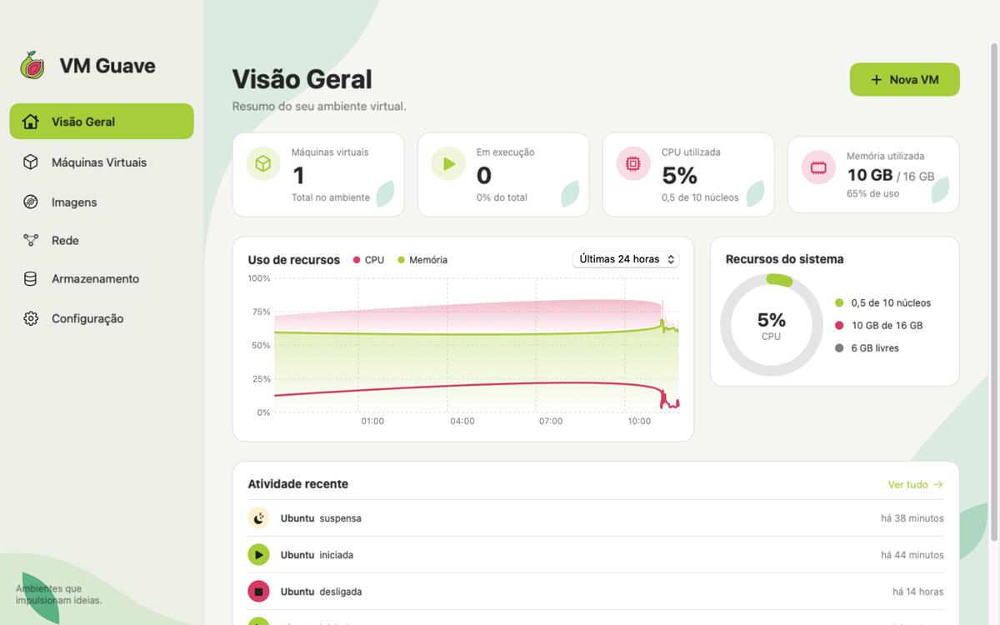
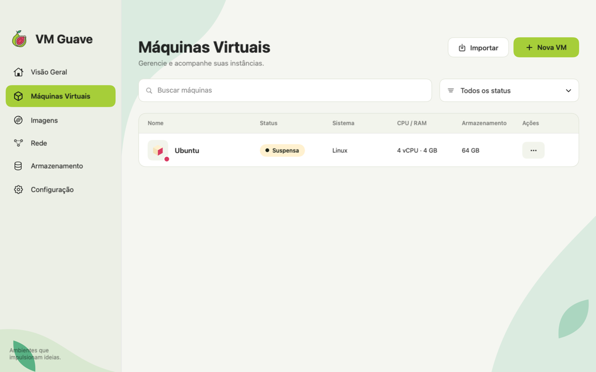
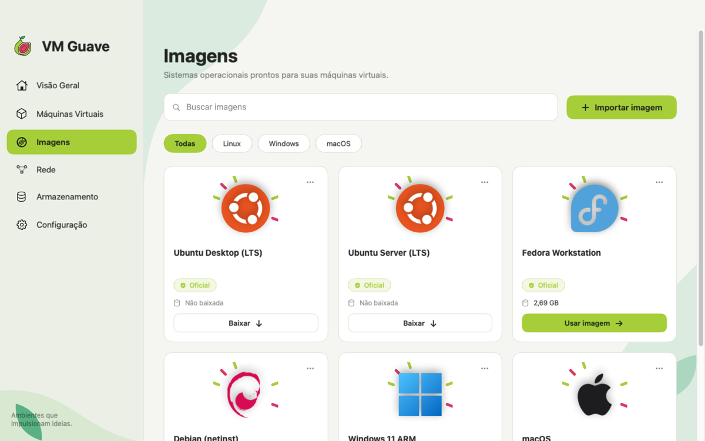
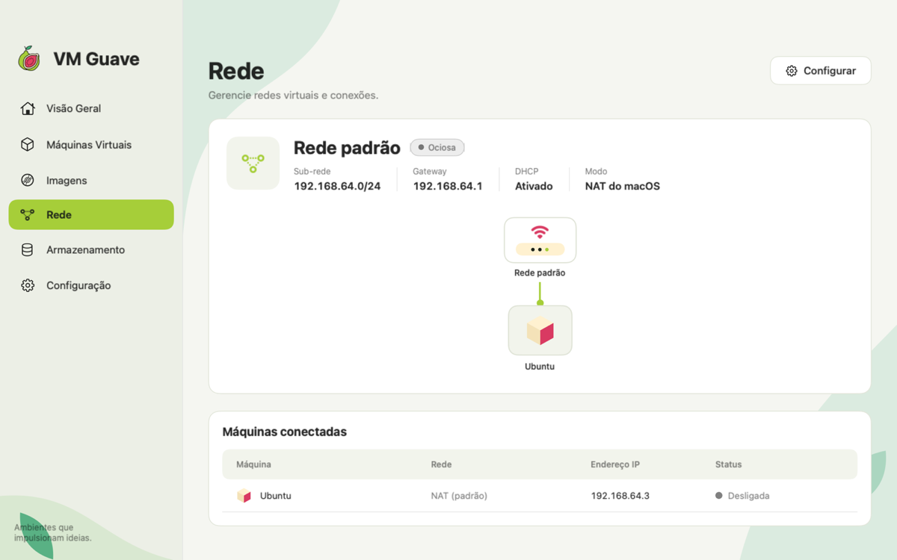

<picture>
  <source media="(prefers-color-scheme: dark)" srcset="assets/header-dark.svg">
  
</picture>

 

<a href="https://marloon-dev.github.io/vm-guave/">
  <picture>
    <source media="(prefers-color-scheme: dark)" srcset="assets/vm-guave/banner-dark.svg">
    
  </picture>
</a>

**VM Guave** é um gerenciador de máquinas virtuais que eu criei do zero. No Mac ele é um app nativo em Swift sobre o `Virtualization.framework` da Apple; no Windows e no Linux, um app em Tauri sobre o QEMU, com aceleração por hardware.

<table>
<tr>
<td width="50%" valign="top">

#### 🍎 No Mac (Apple Silicon)

- 🐧 VMs **Linux**, **macOS** e **Windows 11 ARM**
- 📸 **Snapshots**, suspender e retomar, clonagem
- 🔐 VM **criptografada** com AES-256
- 🌐 Rede com **IP fixo** e diagrama da rede
- ⚡ **Rosetta** para rodar programas x86_64 no Linux
- ⌨️ Linha de comando **`bgctl`**

</td>
<td width="50%" valign="top">

#### 🪟 No Windows e 🐧 no Linux

- 🚀 VMs aceleradas com **WHPX** (Windows) e **KVM** (Linux)
- 📸 **Snapshots** e suspender
- 🔌 **Redirecionamento de portas**
- 📦 Instaladores `.exe`, `.msi`, `.deb`, `.rpm` e `.AppImage`

#### ✨ Em todos

- 🎨 Identidade da goiaba, nos temas **claro e escuro**
- 🔄 **Atualização automática** pelas Releases

</td>
</tr>
</table>

<table>
<tr>
<td width="50%">
<picture>
  <source media="(prefers-color-scheme: dark)" srcset="assets/vm-guave/app-overview-dark.png">
  
</picture>

<b>Visão Geral</b>: uso do Mac e atividade recente

</td>
<td width="50%">
<picture>
  <source media="(prefers-color-scheme: dark)" srcset="assets/vm-guave/app-machines-dark.png">
  
</picture>

<b>Máquinas Virtuais</b>: busca, filtros e ações

</td>
</tr>
<tr>
<td width="50%">
<picture>
  <source media="(prefers-color-scheme: dark)" srcset="assets/vm-guave/app-images-dark.png">
  
</picture>

<b>Imagens</b>: distros, Windows 11 ARM e macOS

</td>
<td width="50%">
<picture>
  <source media="(prefers-color-scheme: dark)" srcset="assets/vm-guave/app-network-dark.png">
  
</picture>

<b>Rede</b>: diagrama e IPs de cada VM

</td>
</tr>
</table>

**Feito com**

SwiftUI · Virtualization.framework · QEMU

 

[**🌐 Conhecer o site**](https://marloon-dev.github.io/vm-guave/) · [Ver repositório](https://github.com/marloon-dev/vm-guave) · [Novidades da última versão](https://github.com/marloon-dev/vm-guave/releases/latest)

> [!TIP]
> É grátis e de código aberto. Se o VM Guave te ajudou, deixe uma ⭐ no [repositório](https://github.com/marloon-dev/vm-guave): isso me ajuda muito!

## 👨‍💻 Sobre mim

- 🎓 Cursando **Engenharia de Software**.
- 🛠️ Transformo meus estudos em projetos práticos, do site institucional ao app nativo de máquinas virtuais.
- 📚 Estudando **Swift**, **Python**, **JavaScript/TypeScript**, **Rust**, **Git** e **GitHub**, rumo ao Full Stack.
- 🌱 Explorando novas tecnologias, lógica de programação e boas práticas de desenvolvimento.
- 💼 Em busca da minha **primeira oportunidade** na área de desenvolvimento de software.

## 📂 Outros projetos

| Projeto | Descrição | Tecnologias |
|---|---|---|
| [**ONG Vidas em Ação**](https://github.com/marloon-dev/projeto-ong) · [ver site](https://marloon-dev.github.io/projeto-ong/) | Site institucional acessível, com design system, tema claro/escuro, galeria e formulário com validação. Testado com Playwright e CI no GitHub Actions. | HTML, CSS, JavaScript, Playwright |
| [**Landing Page**](https://github.com/marloon-dev/landing-page) · [ver site](https://marloon-dev.github.io/landing-page/) | Landing page responsiva. | HTML, CSS |
| [**Cordel Moderno**](https://github.com/marloon-dev/Projeto-cordel) · [ver site](https://marloon-dev.github.io/Projeto-cordel/) | Poema de Milton Duarte com efeito *parallax*. | HTML, CSS |
| [**Python**](https://github.com/marloon-dev/Python) | Exercícios de programação de computadores. | Python |

## 🧰 Tecnologias

**Linguagens e frameworks**

**Banco de dados e plataformas**

**DevOps e utilidades**

**Ferramentas de desenvolvimento e design**

## 📫 Onde me encontrar

 

<picture>
  <source media="(prefers-color-scheme: dark)" srcset="https://raw.githubusercontent.com/marloon-dev/marloon-dev/output/github-snake-dark.svg">
  
</picture>
